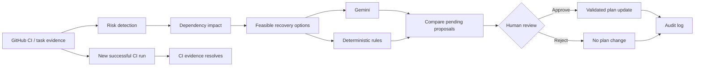
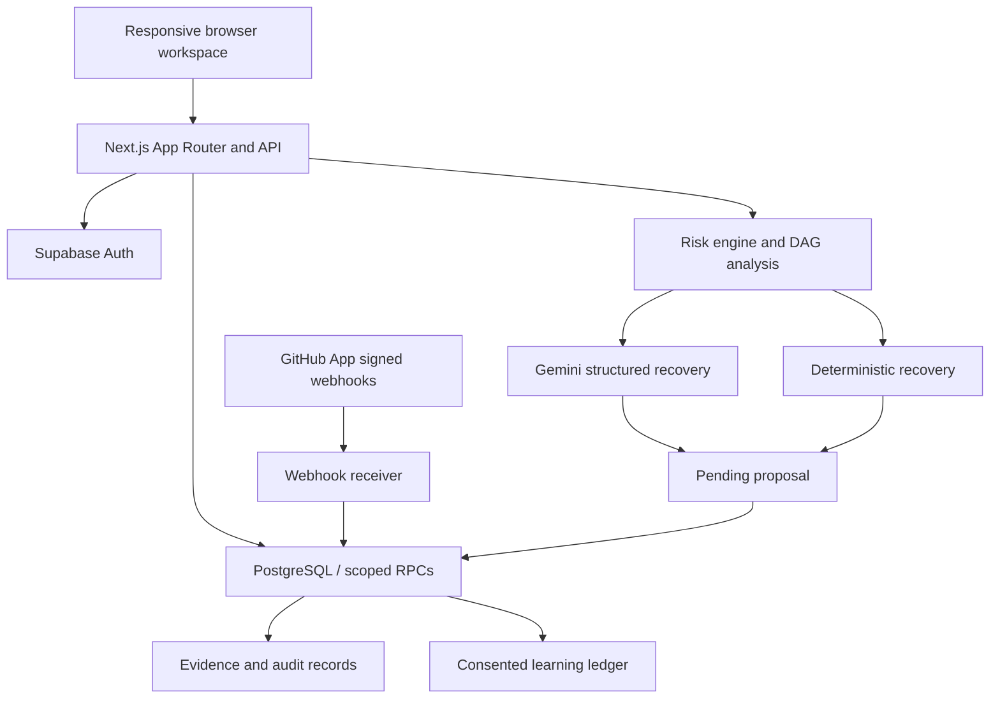

<div align="center">

# 🛡️ TeamFlow Guard

### Human-governed AI delivery intelligence for software teams

**Detect delivery risks. Understand their dependencies. Compare recovery options. Keep humans in control.**

[](https://teamflow-guard.vercel.app)
[](https://nextjs.org/)
[](https://www.typescriptlang.org/)
[](https://supabase.com/)
[](https://ai.google.dev/)
[](https://github.com/SDAFIK/TeamFlow-Guard/actions/workflows/validation.yml)

[**Launch live application →**](https://teamflow-guard.vercel.app) · [Demo walkthrough](DEMO.md) · [Architecture](#architecture) · [Local setup](#local-development) · [Release evidence](#validation-and-release-evidence)

</div>

---

## The problem

Small software teams frequently discover delivery problems too late. A failed CI run, delayed review, blocked dependency or overloaded teammate can affect several downstream tasks. Traditional task boards record work, but the team must still connect the evidence, identify the impact, and decide what to do next.

**TeamFlow Guard** connects these signals to the project plan and offers evidence-backed recovery proposals. A teammate or lead can inspect the reason, compare feasible changes, and approve or reject a proposal. The system does not silently change the approved plan.

## What makes TeamFlow Guard different?

| Capability | TeamFlow Guard |
| --- | --- |
| Evidence-first risk detection | Real GitHub CI signals and explicitly labeled fictional demo events |
| Dependency intelligence | Trace prerequisites, downstream impact and critical estimated dependency effort |
| AI + deterministic rules | Compare Gemini-generated explanations and rule-based recovery proposals |
| Human governance | Validated, versioned proposals; lead approval; persistent audit records |
| Team capacity | Voluntary availability and estimated workload checks, not employee scoring |
| Learning with safeguards | Synthetic model laboratory, owner-consented real-data collection and reviewed candidate training |

## Product tour

| Workspace module | What it does |
| --- | --- |
| **Overview** | Project health, task summaries, risk feed and recovery entry points |
| **TIC Intelligence V2** | Critical dependency effort, evidence-backed warnings, interactive model laboratory and learning controls |
| **Risk Center** | Source evidence, affected tasks, feasible recovery alternatives and AI analysis |
| **Task Board** | Create and update tasks, search/filter work and manage assignments |
| **Dependency Explorer V3** | Dynamic DAG, horizontal/vertical layout, zoom, task focus, draggable cards, animated risk propagation and validated connection proposals |
| **Decision Inbox** | Inspect before/after changes, compare proposals and approve or reject with version checks |
| **Team Capacity** | Report availability and understand estimated workload constraints |
| **Audit Log** | Review recorded decisions and planning changes |
| **Team & Invitations** | Email-bound invitations, role-based access and shared workspaces |
| **GitHub Connection** | Read-only App activity, signed CI ingestion, authorized workflow/PR task mappings and review evidence |

### The intelligent delivery journey



A plan approval does not clear a failed CI run. A later verified successful run resolves the corresponding CI evidence.

## Intelligence: three complementary layers

| Layer | Purpose | Release state |
| --- | --- | --- |
| **Deterministic rules** | Detect evidence-backed risks and enumerate allowed recovery actions | Operational |
| **Gemini** | Explain and choose from validated recovery actions with evidence references | Actual provider tested; human approval required |
| **TIC V2 predictive laboratory** | Explore a logistic model trained on fictional project data | Experimental; real-project probabilities disabled |

The TIC V2 synthetic benchmark uses 12,000 fictional task observations across 120 project groups, with project-disjoint train/validation/test splits. The selected logistic model achieved approximately **0.819 average precision, 0.669 precision, 0.916 recall and 0.200 Brier score** on its held-out synthetic test set. These are **synthetic benchmark metrics, not real-world prediction accuracy**.

The learning ledger supports prospective, owner-consented observations and pseudonymous exports. The offline trainer compares logistic regression, random forest and XGBoost using chronological, project-disjoint partitions. Candidate artifacts are review-only: automatic promotion is disabled, and real-world training, serving validation and activation remain future milestones.

## Architecture



| Technology | Role |
| --- | --- |
| Next.js 16, React 19, TypeScript | Production UI and server routes |
| Tailwind CSS, custom CSS, Lucide | Responsive workspace design |
| React Flow (@xyflow/react) | Interactive dependency graph |
| Supabase Auth + PostgreSQL | Identity, persistence, RLS, scoped database functions |
| Google GenAI SDK + Zod | Structured, validated Gemini recommendations |
| Python / scikit-learn / XGBoost | Offline model research and candidate training |
| GitHub Actions, Vitest, Playwright | Unit, integration and browser regression testing |
| Vercel | Production hosting |

The repository also retains a legacy FastAPI/Python local-development path. The public production application uses the Next.js/Supabase architecture above.

## Try the live demo

1. Visit [teamflow-guard.vercel.app](https://teamflow-guard.vercel.app) and register or sign in.
2. Open a labeled demo workspace (or an existing Sandbox Rehearsal workspace).
3. Go to **TIC Intelligence → Start fresh AI rehearsal**.
4. Inspect the resulting fictional CI failure, then **Compare recovery options**.
5. Enable side-by-side comparison and generate a rule-based proposal and a Gemini proposal.
6. Review one proposal in the Decision Inbox. An authorized lead can approve it; the other may become stale.
7. Explore **Dependencies**: select a task, switch orientation, focus its impact, and propose a new valid dependency.
8. Review the plan version and audit trail. Replay a passing event to demonstrate recovery in the fictional workspace.

See the [full walkthrough](DEMO.md). Demo events are labeled and cannot resolve genuine GitHub evidence. Never use real confidential task data for a public demo.

## Local development

### Prerequisites

- Git and Node.js 24 (npm)
- Docker for a disposable local Supabase stack, or a separate development Supabase project
- Optional Gemini API key for real AI calls; deterministic recovery works without it

```bash
git clone https://github.com/SDAFIK/TeamFlow-Guard.git
cd TeamFlow-Guard
npm ci
npm --prefix web ci
```

**Option A — isolated local Supabase:** use the versioned CLI and the repository migrations.

```bash
npx --yes supabase@2.79.0 start
npx --yes supabase@2.79.0 status
```

Copy `web/.env.example` to `web/.env.local` and fill in the local API URL and publishable/anon key reported by Supabase. Set `APP_BASE_URL=http://127.0.0.1:3000` and `APP_ALLOWED_ORIGINS=http://127.0.0.1:3000`. Configure the matching Auth callback URL in the development Auth settings. Use the local email testing interface for confirmation messages.

**Option B — separate hosted development project:** apply the SQL migrations in order to a new development database, configure Auth and the corresponding URL/publishable key, and use the same environment template. Do not reuse production credentials or reset the production database. Hosted migration history must be reconciled before any migration push.

```bash
npm --prefix web run dev
```

Open [http://127.0.0.1:3000](http://127.0.0.1:3000). Register a development account and create or join a workspace. For the legacy Windows/FastAPI workflow, see [Legacy local setup](docs/LEGACY_LOCAL_README.md).

### Configuration

| Environment variable | Purpose |
| --- | --- |
| `TEAMFLOW_BACKEND=supabase` | Select the production-style backend |
| `NEXT_PUBLIC_SUPABASE_URL`, `NEXT_PUBLIC_SUPABASE_PUBLISHABLE_KEY` | Supabase public connection settings |
| `APP_BASE_URL`, `APP_ALLOWED_ORIGINS` | Exact trusted application origins |
| `GEMINI_API_KEY`, `GEMINI_MODEL` | Server-only AI provider configuration; validated model: `gemini-3.1-flash-lite` |
| `GITHUB_APP_ID`, `GITHUB_APP_PRIVATE_KEY`, `GITHUB_APP_WEBHOOK_SECRET` | Server-only App identity and webhook authentication |
| `TEAMFLOW_GITHUB_APP_BINDINGS` | Administrator-approved workspace/repository installation bindings |
| `TEAMFLOW_GITHUB_CI_MAPPINGS`, `TEAMFLOW_GITHUB_REVIEW_MAPPINGS` | Optional administrator-managed mappings |
| `TEAMFLOW_GITHUB_INGEST_KEY` | Privileged server-only evidence ingestion credential |
| `TEAMFLOW_GMAIL_USER`, `TEAMFLOW_GMAIL_APP_PASSWORD` | Optional direct invitation email delivery |

Never commit `.env.local`, private keys, service-role credentials, tokens, or real learning exports. Only Supabase's public URL and publishable key belong in browser-visible configuration.

### GitHub integration

The production receiver is `POST /api/github/webhook`. It validates raw-body HMAC-SHA256 signatures, immutable repository/installation identifiers, tracked branches, explicit mappings, and event ordering/deduplication. CI ingestion never mutates the approved plan.

An administrator authorizes a repository through the GitHub App. Workspace managers can then add CI workflow and PR-review task mappings in **GitHub connection → Integration setup**. The new database mappings are add-only to preserve historical evidence; existing administrator mappings retain precedence.

For full review lifecycle delivery, subscribe to **Pull request**, **Pull request review** and **Workflow run** events. Review-comment events are not a substitute for review-submission events. Repository authorization remains administrator-managed.

## Security and governance

- Workspace-scoped membership and role checks; owners/managers approve protected proposals.
- Supabase RLS and restricted database RPCs; browser-supplied roles cannot grant access.
- Secure session cookies and trusted-origin checks for mutations.
- Optimistic plan versions, idempotent decisions and cycle validation.
- AI outputs constrained to allowed actions and evidence; invalid or unavailable provider responses fail safely.
- Signed GitHub events and read-only repository access; no automatic plan changes.
- Owner-controlled learning consent and pseudonymous exports; no individual performance ratings.

## Validation and release evidence

| Verification | Evidence |
| --- | --- |
| Intelligence and graph release | [PR #17](https://github.com/SDAFIK/TeamFlow-Guard/pull/17) · [Authenticated acceptance](https://github.com/SDAFIK/TeamFlow-Guard/actions/runs/43390956285) |
| AI comparison and graph scalability | [PR #18](https://github.com/SDAFIK/TeamFlow-Guard/pull/18) · [Authenticated acceptance](https://github.com/SDAFIK/TeamFlow-Guard/actions/runs/43391423711) |
| Workspace-managed GitHub mappings | [PR #19](https://github.com/SDAFIK/TeamFlow-Guard/pull/19) · [Authenticated acceptance](https://github.com/SDAFIK/TeamFlow-Guard/actions/runs/43392725571) |
| Production deployment | [Live application](https://teamflow-guard.vercel.app) |

The release tests exercise actual local Supabase Auth/PostgREST, multi-user workspace isolation, fictional signed GitHub events, graph drag-and-drop, dependency approvals, cycle rejection, recovery comparison, and desktop/mobile Intelligence UI. The separate real Gemini provider smoke test passed; authenticated Gemini browser tests use an intercepted provider response. Real CI failure/recovery ingestion has also been verified in a dedicated acceptance workspace.

```bash
npm --prefix web run lint
npm --prefix web run typecheck
npm --prefix web test
npm --prefix web run build
```

The [validation workflow](.github/workflows/validation.yml) and [authenticated acceptance workflow](.github/workflows/phase5b-local-acceptance.yml) document the reproducible CI environment. Authenticated tests use disposable local databases, not production records.

## Repository structure

```text
TeamFlow-Guard/
├── web/
│   ├── app/                 # Next.js pages and production API routes
│   ├── components/          # Workspace, graph, intelligence and dialogs
│   ├── domain/              # Risk, graph, recovery and TIC model logic
│   └── server/              # Auth, persistence, Gemini and GitHub integrations
├── supabase/migrations/     # Versioned PostgreSQL schema and RPCs
├── scripts/                 # Acceptance tests, offline training and local tooling
├── api/                     # Legacy FastAPI development backend
├── tests/                   # Browser tests
├── docs/                    # Technical notes and legacy setup
└── .github/workflows/       # CI and release validation
```

## Roadmap and honest limitations

- Complete genuine GitHub PR review-submission/recovery verification with the correct event subscription and an eligible reviewer.
- Add fully self-service GitHub App installation for new customer repositories; current task mapping requires an administrator-authorized repository.
- Collect sufficient consented real project outcomes, independently validate a real candidate model, and implement reviewed serving promotion/rollback.
- Continue full hosted authenticated UX, accessibility, security and performance testing. Current browser acceptance is isolated; public route checks are not equivalent to every authenticated production journey.
- Workspace synchronization uses polling and same-browser notifications, not a guaranteed real-time event stream.

## Contributing

Open an issue describing the problem, expected behavior and reproduction steps. Work on a feature branch, add regression tests, and submit a pull request. Keep real data, secrets and session traces out of commits. Changes to planning logic must preserve approval, tenant isolation and audit guarantees.

---

<div align="center">

**TeamFlow Guard · WorkforceOS project**

Built to help software teams recover from delivery risks without surrendering control of their project plan.

[Live website](https://teamflow-guard.vercel.app) · [GitHub repository](https://github.com/SDAFIK/TeamFlow-Guard) · [Issues](https://github.com/SDAFIK/TeamFlow-Guard/issues)

</div>
